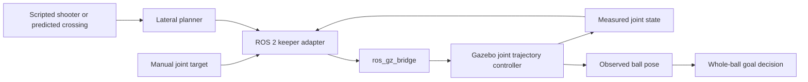

# Goalkeeper Architecture

The active configuration is `config/keeper.design.json`. Its generator produces the URDF, solid diamond mesh, goal world, ball model, and front-elevation drawing. The launch reads those installed artifacts and creates the keeper on the same goal frame used by the planner.

| Stage | Responsibility |
| --- | --- |
| Prediction | Supply ball-centre Y, Z and arrival time at the goal plane. Scripted trials use a known target; a camera/tracker can later publish the same contract. |
| Planner | Search safe lateral positions using the remaining time, exact diamond geometry and swept clearance. Generate rest-to-rest samples. |
| Adapter | Validate measured joint state, reject overlapping or unsafe moves, and publish a single trajectory. The bridge translates ROS messages to Gazebo Transport. |
| Gazebo | Track position samples through the Harmonic controller and return measured joint feedback. A prismatic joint substitutes for a powered wheeled base. |
| Scoring | Observe Gazebo ball poses, test forward whole-ball crossing, and record the result separately from planner reachability. |

See the [robot design and validation](robot-design.md), [active interfaces](interfaces.md), and [Gazebo Harmonic controller documentation](https://gazebosim.org/api/sim/8/jointcontrollers.html). No hardware actuation or camera-based prediction is implemented here.
