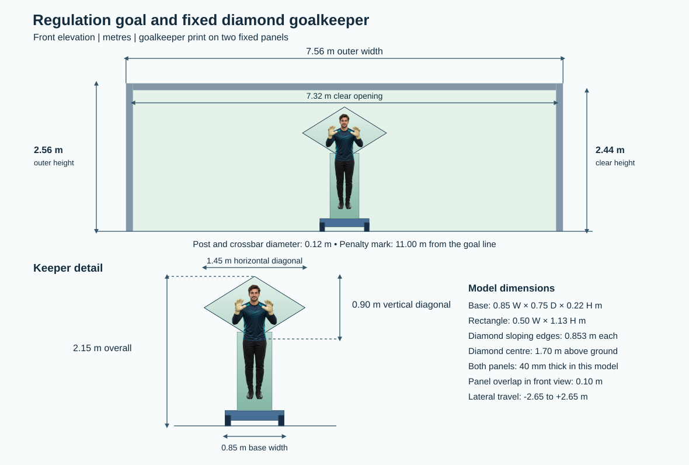

# Fixed Diamond Goalkeeper

The robot uses one fixed **solid diamond panel** over a narrower **fixed rectangular panel** on the existing wheeled base. Both panels move with the base. There are no shoulder, elbow or tilt actuators in this version.



The front carries one continuous goalkeeper portrait across the two plates: the face and bent arms appear on the diamond, and the rest of the figure continues on the rectangle. The artwork is a visual decal; the plate outlines, collision geometry and slide motion stay the same.

| Part | Dimensions and placement |
| --- | --- |
| Upper diamond | Horizontal tip-to-tip **1,450 mm**; vertical tip-to-tip **900 mm**; four edges **853.3 mm** each |
| Diamond reference points | Centre **1,700 mm above ground**; side points **725 mm** from centreline; upper tip **2,150 mm**; lower tip **1,250 mm** above ground |
| Diamond edge angles | **31.83°** to the horizontal; left/right tip interior angles **63.65°**; upper/lower tip interior angles **116.35°** |
| Lower rectangle | **500 mm wide × 1,130 mm high**, from **220 mm to 1,350 mm** above ground |
| Connection geometry | **100 mm** vertical overlap in the front projection; diamond mounted immediately in front of the rectangle, with the two plate faces touching in the model |
| Model plate thickness | **40 mm** for each panel; geometry assumption only, not a structural thickness or material specification |
| Wheeled base | **850 mm wide × 750 mm deep × 220 mm high**, including the wheels |
| Overall assembly | **2,150 mm high**; maximum width **1,450 mm** at the diamond |
| Goal / penalty mark | Outside frame **7.56 × 2.56 m**; clear opening **7.32 × 2.44 m**; diameter **0.12 m**; penalty distance **11.00 m** |

For a flat layout, set the diamond centre at (0, 0) mm and mark (−725, 0), (0, +450), (+725, 0), and (0, −450). Connect adjacent points. The dimensions above define the outline; mounting brackets and structural strength are outside this simulation.

The plate generator writes a closed rhombus prism. The URDF uses the same mesh for appearance and collision, and the planner uses its exact four-sided front projection, not its enclosing rectangle. The base stays level and uses `slide_joint` to approximate lateral rolling. It has a travel range of ±2.65 m, speed limit 2.0 m/s and acceleration limit 4.0 m/s². The body is one fixed assembly, so there are no articulated self-collisions. A planned slide must still clear the pitch, posts and crossbar.

The simulation keeps 85 kg of mobile mass: 38 kg chassis shell, 4 × 1 kg wheels, 25 kg lower assembly and 18 kg upper assembly. The URDF generator computes inertia using box, cylinder and uniform rhombus-prism assumptions. The ideal net lateral force is 85 × 4.0 = 340 N, excluding rolling loss and traction. These are simulation values.

## Run and check

```bash
python3 tools/generate_geometry.py
python3 tests/test_regulation_geometry.py -v
python3 run_keeper.py demo --case low --path-csv action_path.csv
```

Build as in the [README](../readme.md), then launch with `ros2 launch goalkeeper_sim simulation.launch.py`. For a manual check, run one command at a time after `/keeper/ready` is true:

```bash
ros2 topic pub --once /keeper/manual_pose std_msgs/msg/String '{data: "{\"slide_m\": 0.35}"}'
ros2 topic pub --once /keeper/manual_pose std_msgs/msg/String '{data: "{\"slide_m\": -0.35}"}'
ros2 topic echo /joint_states --once
```

Start a fresh launch for each deterministic trial with `shoot:=true shot_case:=center`, `shot_case:=low` or `shot_case:=high_corner`. Check `/keeper/shot_result` for the observed goal decision, separate from the planner result.

| Trial (goal-plane Y, Z) | Offline result |
| --- | --- |
| Centre (0.00, 1.28 m) | Reachable from centre; no slide required |
| Low (+0.56, 0.11 m) | Reachable; slides +0.08 m, about 0.283 s of motion |
| High corner (+3.44, 2.27 m) | Unreachable; above the fixed panel's coverage |

The base centre is aligned to the goal line and the diamond face lies on the pitch side, so the panel can contact the ball before it crosses. The offline motion budget is 0.405 s (0.55 s flight minus 0.10 s processing, 0.02 s settling and a 0.025 s early-contact reserve). The reserve approximates the earliest front-face contact at about 20 m/s; it is not a measured timing guarantee. Runtime also reserves 0.012 s for the bridge. These checks do not establish physical saves. Live ROS 2/Gazebo launch, collision response and tracking remain unverified on this Windows machine.
