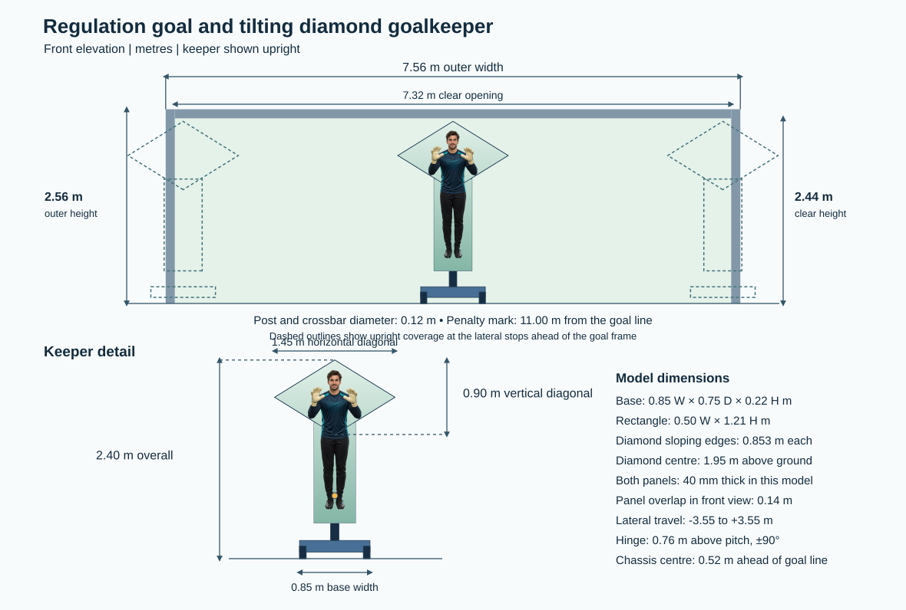

# Tilting Diamond Goalkeeper

The solid diamond and the narrower rectangle form one board. The board tilts in the plane of the goal about a hinge **0.76 m above the pitch**. At either horizontal endpoint, the diamond extends past the side of the chassis and its lowest tip is **35 mm above the pitch**. The wheeled chassis remains level and carries the hinge sideways.



The front carries one continuous goalkeeper portrait. The face and bent arms appear on the diamond and the rest of the figure continues onto the rectangle. The decal rotates with both plates.

| Part | Dimensions and placement |
| --- | --- |
| Upper diamond | Horizontal tip-to-tip **1,450 mm**; vertical tip-to-tip **900 mm**; four edges **853.3 mm** each |
| Diamond reference points | Centre **1,950 mm above ground**, side points **725 mm** from centreline, upper tip **2,400 mm**, and lower tip **1,500 mm** |
| Diamond edge angles | **31.83°** to the horizontal; left/right tip interior angles **63.65°**; upper/lower tip interior angles **116.35°** |
| Lower rectangle | **500 mm wide × 1,210 mm high**, from **430 mm to 1,640 mm** above ground when upright |
| Connection geometry | **140 mm** vertical overlap in the front projection. The diamond is immediately in front of the rectangle, with the plate faces touching in the model. |
| Model plate thickness | **40 mm** for each panel; geometry assumption only, not a structural thickness or material specification |
| Wheeled base | **850 mm wide × 750 mm deep × 220 mm high**, including the wheels |
| Upright assembly | **2,400 mm high**, with **40 mm** clearance under the crossbar. Maximum upright width **1,450 mm** at the diamond. |
| Goal / penalty mark | Outside frame **7.56 × 2.56 m**, clear opening **7.32 × 2.44 m**, frame diameter **0.12 m**, penalty distance **11.00 m** |

For a flat layout, set the diamond centre at (0, 0) mm and mark (−725, 0), (0, +450), (+725, 0), and (0, −450). Connect adjacent points. The dimensions above define the outline; mounting brackets and structural strength are outside this simulation.

The URDF uses the closed diamond mesh for appearance and collision. The planner uses the actual shape of the rectangle and diamond at each candidate pose. The level chassis uses `slide_joint` to approximate lateral rolling, with travel limits of **±3.55 m**, a speed limit of **17 m/s** and an acceleration limit of **75 m/s²**. Its centre runs **0.52 m in front of the goal line**, leaving **25 mm** between the back of the chassis and the front of the posts. The board uses `tilt_joint` with limits of ±90°, 6.5 rad/s and 40 rad/s². The two axes can move at the same time. Swept clearance checks the pitch, chassis and the depth separation from the goal frame.

A goal-bound ball of radius 0.11 m can have its centre between Y = −3.55 m and +3.55 m and between Z = 0.11 m and 2.33 m. For every such point in the front projection, an upright keeper aligned laterally with that point covers it. This describes positioning over the entire range. The controller still uses goal-line target Y/Z as an approximate interception point. A prediction of the ball at the keeper's forward position would improve the aim for oblique or rising shots.

The 85 kg moving mass comprises a 37 kg chassis shell, 1 kg hinge support, four 1 kg wheels, a 25 kg lower assembly and an 18 kg upper assembly. The generator computes link inertias from boxes, cylinders, and a uniform rhombus prism. Accelerating the 85 kg model at 75 m/s² with the board fixed requires 6,375 N before rolling loss. The trajectory controller also accounts for the coupling force and torque when the board tilts. The model applies force through an ideal linear joint. A physical chassis would need a separately validated drive and braking system.

## Run and check

```bash
python3 tools/generate_geometry.py
python3 tests/test_regulation_geometry.py -v
python3 run_keeper.py demo --case low --path-csv action_path.csv
```

Build as in the [README](../readme.md), then run `ros2 launch goalkeeper_sim simulation.launch.py demo:=true` to see the built-in sequence. To use manual commands, launch without `demo:=true`, then send one command at a time after the previous move has finished.

```bash
ros2 topic pub --once /keeper/manual_pose std_msgs/msg/String '{data: "{\"slide_m\": 0.35}"}'
ros2 topic pub --once /keeper/manual_pose std_msgs/msg/String '{data: "{\"slide_m\": -0.60, \"tilt_rad\": 0.60}"}'
ros2 topic echo /joint_states --once
```

Start a fresh launch for each deterministic trial with `shoot:=true shot_case:=center`, `shot_case:=low` or `shot_case:=high_corner`. Check `/keeper/shot_result` for the observed goal decision, separate from the planner result.

| Trial (goal-plane Y, Z) | Offline result |
| --- | --- |
| Centre (0.00, 1.28 m) | Reachable from centre; no slide required |
| Low (+0.56, 0.11 m) | Planner finds +0.08 m slide in about 0.065 s |
| High corner (+3.44, 2.27 m) | Offline planner finds +2.68 m slide and −26° tilt in about 0.378 s |

The 0.379 s offline motion budget assumes 0.55 s flight time, 0.10 s processing, 0.02 s settling and a 0.051 s early-contact reserve. The reserve includes 0.026 s for the 0.52 m forward offset at the assumed average shot speed of 20 m/s. The live adapter also deducts 0.012 s for the ROS–Gazebo bridge. The offline high-corner result therefore does not establish a live save.

The separate 0.50 s movement benchmark starts each outward move from centre. The nominal profile covers 3.55 m and rotates the board to horizontal in 0.435 s before tracking and settling. A single move across the entire 7.10 m from stop to stop takes at least 0.644 s at the configured limits.

Gazebo Harmonic measured 0.465 s from the command timestamp to settling at +3.55 m and −90°, and 0.458 s to settle at −3.55 m and +90°. Settling required 20 ms with position errors within 0.02 m and 1°, and speeds within 0.10 m/s and 0.10 rad/s. The peak measured slide speed was 16.20 m/s. These are simulated movement times.
