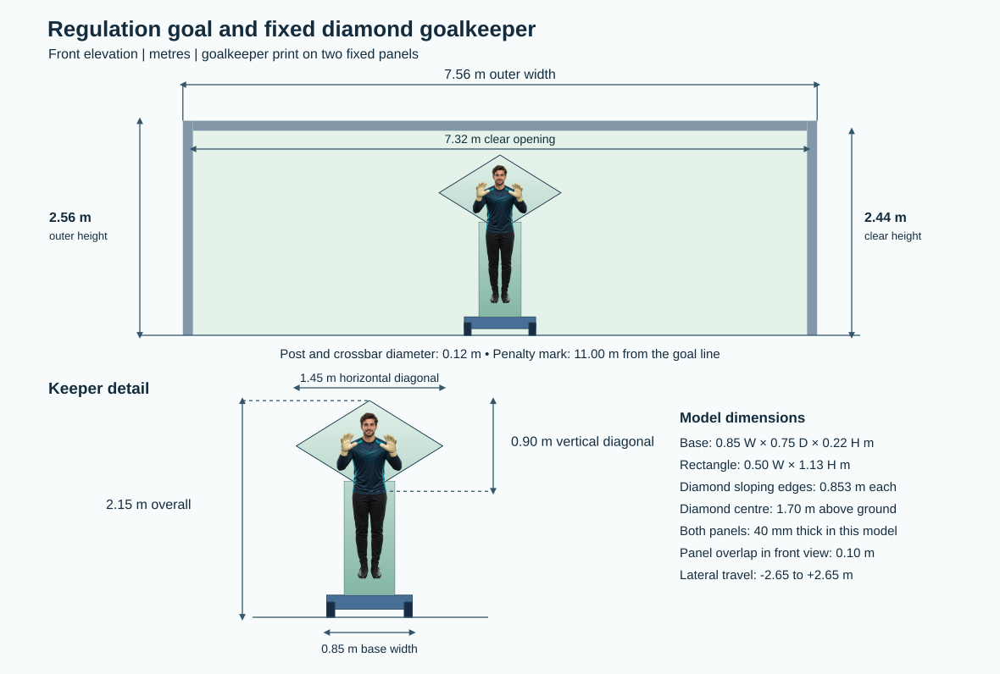

# MIE1075 Project: Autonomous Goalkeeper Robot

The regulation goal has a **7.56 m × 2.56 m outer frame** and a **7.32 m × 2.44 m clear opening**. The level wheeled chassis carries a **solid diamond panel over a fixed rectangle**, with an overall height of **2.15 m**. Gazebo approximates sideways rolling with one prismatic joint.



## Build and run

Use Ubuntu 24.04 with ROS 2 Jazzy and Gazebo Harmonic. From the repository root:

```bash
source /opt/ros/jazzy/setup.bash
rosdep install --from-paths src --ignore-src -r -y
colcon build --base-paths src
source install/setup.bash
ros2 launch goalkeeper_sim simulation.launch.py
```

The launch loads the generated world and URDF, a Gazebo joint trajectory controller, state feedback, and the ROS adapter. In a second sourced terminal, check readiness and joint state:

```bash
ros2 topic echo /keeper/ready --once
ros2 topic echo /joint_states --once
```

See [robot design and validation](docs/robot-design.md) for the manual movement sequence and scripted shot runs. For an offline check with Python 3 alone:

```bash
python3 tools/generate_geometry.py
python3 tests/test_regulation_geometry.py -v
python3 run_keeper.py demo --case low --path-csv action_path.csv
```

`config/keeper.design.json` is the active parameter file. Regenerate and rebuild after changing it. See [architecture](docs/architecture.md), [interfaces](docs/interfaces.md), and the [integration plan](docs/implementation-plan.md). The offline checks passed; live Gazebo tracking and shot outcomes still need to be recorded.
